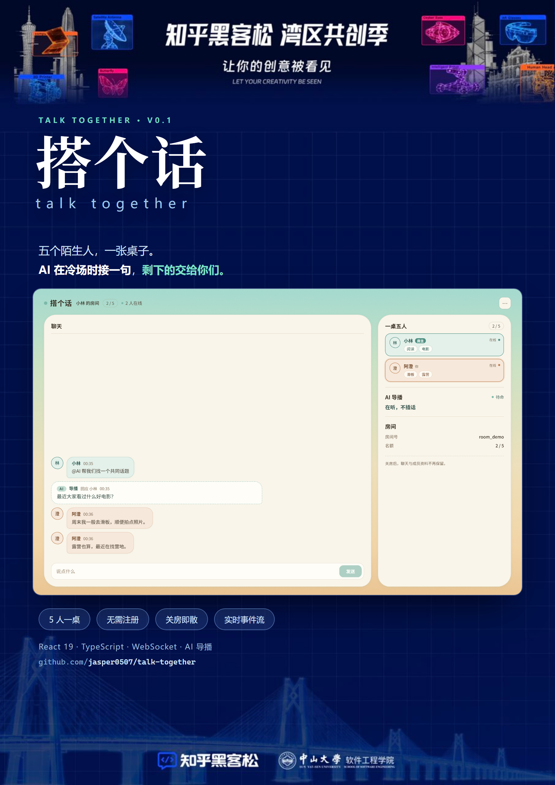

# 搭个话 · TalkTogether

> 五个陌生人，一张桌子。AI 在冷场时接一句，剩下的交给你们。

一个**真人主持 + AI 辅助**的线上陌生人破冰房间：房主开一桌、发邀请，最多五人临时落座；没有账号、没有好友关系，聊完关房即散。冷场时房主可以 `@AI` 让导播接一句，AI 只补话、不抢话。



## 它解决什么

陌生人视频/语音破冰的常见问题是「不知道说什么」和「主持人撑不住场」。搭个话把这两件事拆开：

- **人负责节奏**：房主开房、邀请、移人、关房，话题由人掌握；
- **AI 负责兜底**：只在被 `@` 或冷场时补一句具体、可接的话题，不刷屏、不主导；
- **身份是临时的**：不需要注册，进来填个昵称和兴趣就能坐下，关房后聊天与资料都不保留。

## 已实现的功能

| 模块 | 说明 |
| --- | --- |
| 开房 / 入房 | 邀请链接 + 一次性邀请码，5 人上限，昵称唯一，兴趣标签可自由填写 |
| 房间 | 成员名片（个人色 + 兴趣标签 + 在线/掉线倒计时）、AI 导播面板、房间信息 |
| 聊天 | 消息流按作者着色，AI 回复流式输出，失败/取消有明确状态 |
| 房主 | 邀请（二维码）、移出成员、关闭房间、改自己的资料 |
| 实时 | WebSocket 事件流：快照 + 增量，断线退避重连，房主掉线 60 秒倒计时 |
| 边界 | 被移出、房间关闭、入房结束、跨标签页同步、限频冷却 |

## 技术栈

- **前端**：Vite 7 + React 19 + TypeScript（strict）+ Tailwind v4，无状态库，`useReducer` + `useSyncExternalStore`
- **契约**：OpenAPI 3.1 / JSON Schema 2020-12，前端只 `import type`，不做运行时校验
- **实时**：WebSocket（票据换连、快照对齐、`sequence` 游标去重）
- **Mock**：Prism（HTTP）+ 自建 WS 回放（`contracts/examples/ws/*.json` 共 12 个场景）

## 目录

```
frontend/          前端应用（Vite + React）
  src/pages/       首页 / 开房 / 入房 / 房间
  src/features/    聊天、成员、邀请、资料表单
  src/state/       房间状态归并、会话与入房请求
  src/shared/      API 客户端、实时连接、跨标签广播
contracts/         契约、示例、Mock 场景
docs/              需求、设计、协议与联调文档
design/            视觉稿与作品物料（海报、截图）
```

## 本地运行

```bash
# 前端
cd frontend
npm install
npm run dev            # http://localhost:5173

# 另开两个终端，起契约 Mock
cd contracts
npm run mock:http      # :4010
npm run mock:ws -- host-stream   # :4011
```

打开 `http://localhost:5173`：

- **开一个房间** → 填资料 → 创建后进房（房主视角）
- 或点 **用演示房间进去看看** → 走真实入房流程（成员视角）

需要真实后端时，把 `frontend/.env.example` 里的 `VITE_API_BASE` 指向后端即可，前端代码不用改。

## 测试

```bash
cd frontend
npm test          # 46 条：12 个 WS 场景回放 + 34 条归并 / 会话 / 终态 / 重试规则
npm run typecheck
npm run build
```

## 文档

- 需求与范围：[docs/frontend/requirements.md](docs/frontend/requirements.md)
- 实现方案：[docs/frontend/implementation-plan.md](docs/frontend/implementation-plan.md)
- 视觉规范：[docs/frontend/design-system.md](docs/frontend/design-system.md)
- 联调交接：[docs/frontend/integration.md](docs/frontend/integration.md)
- 协议：[docs/api.md](docs/api.md) · [docs/api/wire.md](docs/api/wire.md)
- 契约与示例：[contracts/README.md](contracts/README.md)

## 状态

V0.1 前端已完成并对契约 Mock 验证；后端尚未实现，联调按 [docs/frontend/integration.md](docs/frontend/integration.md) 的 9 个场景进行。

## License

待补充（建议 MIT）。
